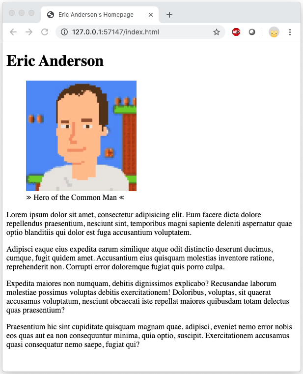
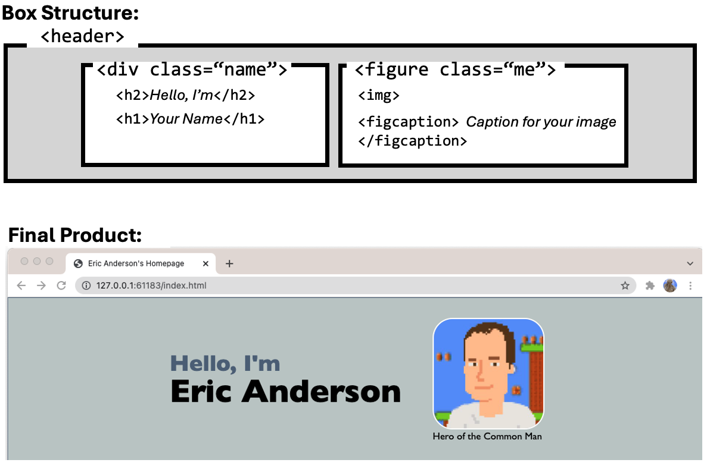
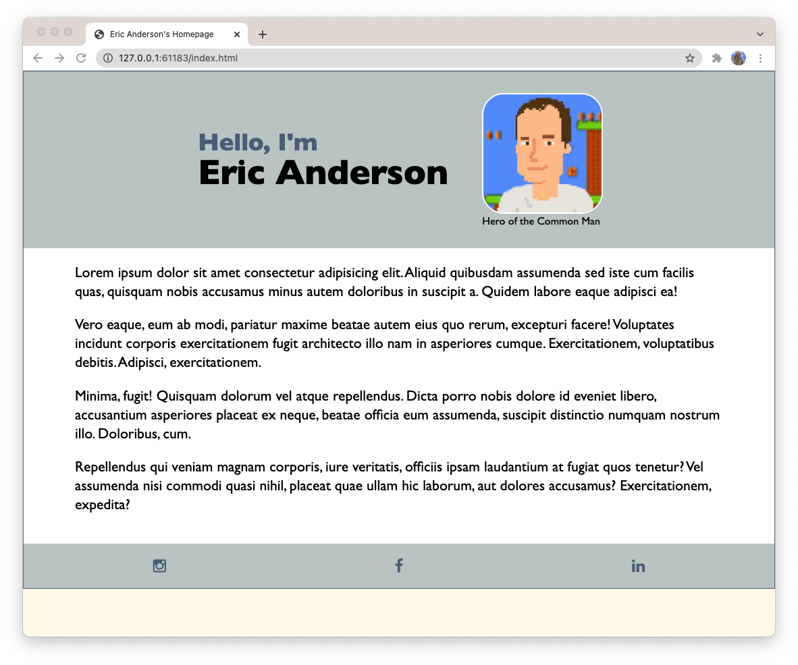

# 📄 Personal Homepage

Build your own personal homepage from scratch, then come back to it twice this term to improve it
as you learn new skills.

## 🎯 Overview

This is a three-stage project, and every stage happens in **this same repo**:

| Stage | Canvas assignment | What you do | Points |
| --- | --- | --- | --- |
| [**Stage 1**](#-stage-1--personal-homepage-v1) | A1: Personal Homepage v1 | Write clean, well-structured HTML about yourself, with a photo. No CSS. | 35 |
| [**Stage 2**](#-stage-2--updated-homepage) | A3: Updated Homepage | Revise the HTML and add box elements (`header`, `main`, `footer`) that split the page into areas. No CSS. | 10 |
| [**Stage 3**](#-stage-3--styled-homepage) | A6: Styled Homepage | Add a reset stylesheet and your own stylesheet, use Flexbox in the header and footer, and add Font Awesome icons. | 20 |

Each stage is submitted as its own pull request. After a stage is graded, you merge that pull
request and open a new one for the next stage. The steps are in the
[Submitting guide](SUBMITTING.md#-three-stages-one-repo).

> [!IMPORTANT]
> **The videos for each stage are in Canvas**, on that stage's assignment page. Stage 1 has no
> follow-along video: you write the page yourself.

> [!NOTE]
> **A few steps in this repo are different from the videos.** Follow the videos for the HTML and
> CSS, and follow this repo for getting your files and submitting:
>
> - **Your folder:** don't create a `web-design-1/homepage` folder by hand. Your folder is the
>   repo you create from this template and clone in WebStorm, as described in the
>   [Getting Started guide](GETTING_STARTED.md). You create it **once**, for Stage 1.
> - **Your file:** your page is `index.html` in the root of the repo. GitHub Pages only serves
>   `index.html` at your site's root URL.
> - **Submitting:** don't zip your folder or upload a file. Publish your page to GitHub Pages and
>   submit a pull request URL in Canvas, as described in the
>   [Submitting guide](SUBMITTING.md).

---

## 🏠 Stage 1 — Personal Homepage v1

Code your own HTML personal homepage from scratch, without a follow-along video. The focus is on
clean, well-structured HTML. Don't worry about the visual design yet, and don't add any CSS.

### 📋 Requirements

**Basic page setup**

- [ ] `<!DOCTYPE html>` declaration and opening and closing `<html>` tags
- [ ] A `<head>` with:
  - [ ] a `<title>` with your full name, like *Taylor Morgan's Homepage*
  - [ ] `<meta charset="UTF-8">`
- [ ] A `<body>` with the content below

**Required page content**

- [ ] An `<h1>` with your first and last name
- [ ] A `<figure>` containing:
  - [ ] an `` of yourself with an `alt` attribute
  - [ ] a `<figcaption>` describing the image (for example, *This is me at the beach.*)
- [ ] At least four `<p>` paragraphs about you
- [ ] At least one special character (see [Fun Symbols](#-fun-symbols) below)
- [ ] At least **two** elements from the optional elements list below

> [!TIP]
> **When to use `<figure>`:** you're using it here because it groups an image with its caption.
> Only use `<figure>` when the image has a meaningful caption. A decorative image (like a logo or
> icon) or an image with no caption should be an `` on its own.

**Optional elements (pick at least 2)**

You can use more than two. Use them meaningfully, not as filler.

| Category | Elements |
| --- | --- |
| Structure & headings | `<h2>`, `<h3>`, `<section>`, `<hr>` |
| Emphasis & formatting | `<em>`, `<strong>`, `<small>`, `<sub>`, `<sup>` |
| Lists | `<ul>`, `<ol>` |
| Other | `<a>` (link to your favorite site), `<span>`, `<div>`, `<abbr>` |

### 📁 Files and Your Photo

Your code has to know exactly where to find your HTML file and images, so file names and folders
matter.

1. Create **`index.html`** in the root of your repo. This exact name, all lowercase.
2. Create an **`images`** folder and put one photo of yourself in it.
3. Resize the photo so it fits on a web page:
   - Width: **500–800 pixels**
   - File size: **under 500 KB**
   - Tools: Preview (Mac), Photos (Windows), or a free online image resizer. The **Resizing an
     Image** video in Canvas shows how.
4. Point to it from your page:
   ```html
   
   ```

```
personal-homepage/
├── index.html
└── images/
    └── your-photo.jpg
```

### ✨ Code Quality

- Indent nested HTML to show its structure. VS Code can do it for you: right-click an empty area of
  the editor and choose **Format Document**.
- Use lowercase for all tag names and file names.
- Check your image's `src` path and `alt` text.
- Open your page in a browser to check that everything works.

### 🎬 Videos in Canvas

| Video | What it covers |
| --- | --- |
| **Getting Started** | Setting up your page. The video creates a `homepage` folder by hand; use your repo instead. |
| **Resizing an Image** | Shrinking your photo to a web-friendly size. |

### 🖼️ Example Output

Your content will be different, but a finished Stage 1 page looks something like this. With no
CSS, it uses the browser's default styles.



### 🎉 Fun Symbols

These special characters work in HTML and can make your page more fun. Use the code to display the
symbol. You can find more at [htmlsymbols.xyz](https://htmlsymbols.xyz/).

| Symbol | Code | Symbol | Code | Symbol | Code |
| --- | --- | --- | --- | --- | --- |
| ♥ | `&hearts;` | ★ | `&#9733;` | ☕ | `&#9749;` |
| ✨ | `&#10024;` | 🎓 | `&#127891;` | 🐱 | `&#128049;` |
| 🎮 | `&#127918;` | 🎵 | `&#127925;` | ✈ | `&#9992;` |
| 🌍 | `&#127757;` | 📚 | `&#128218;` | 💻 | `&#128187;` |
| 🐶 | `&#128054;` | 🧋 | `&#129483;` | 🌟 | `&#127775;` |
| 🎨 | `&#127912;` | 🏀 | `&#127936;` | 🐾 | `&#128062;` |
| 🎧 | `&#127911;` | 🧠 | `&#129504;` | 🌈 | `&#127752;` |

```html
<p>I &hearts; cats and drink too much coffee &#9749;.</p>
```

### 🧮 Stage 1 Grading

Stage 1 is worth **35 points**.

| Criteria | Full credit | Points |
| --- | --- | --- |
| **Page setup** | `DOCTYPE`, `html`, `head` with `meta charset` and a `title` with your full name, and `body` | 5 |
| **Heading** | An `h1` with your first and last name | 3 |
| **Figure** | A `figure` with your photo (`img` with `alt` text) and a `figcaption` | 6 |
| **Paragraphs** | At least four `p` paragraphs about you | 6 |
| **Special character** | At least one special character entity | 2 |
| **Optional elements** | At least two elements from the optional list, used meaningfully | 4 |
| **Files and image** | `index.html` in the root; photo in `images/`, resized, and loading correctly | 4 |
| **Code quality** | Indented, lowercase tags and file names | 3 |
| **Published and submitted** | Live on GitHub Pages, and an open pull request with the live URL submitted in Canvas | 2 |
| **Total** | | **35** |

### ✅ Before You Submit Stage 1

- [ ] Your page is named `index.html` (not `index.html.txt`) and is in the root of the repo
- [ ] Your photo is in `images/`, under 500 KB, and shows up on the page
- [ ] Every requirement above is checked off
- [ ] There's no CSS yet
- [ ] The page is live on GitHub Pages and the URL is in your pull request
- [ ] You **didn't** merge the pull request

---

## 📦 Stage 2 — Updated Homepage

Go back into your Stage 1 HTML, revise it, and add box elements that split your page into separate
areas. In Stage 3 you'll style these boxes.

**No CSS for this stage**, only HTML updates.

> [!IMPORTANT]
> **Before you start:** make sure your Stage 1 pull request has been graded and **merged**, then
> keep working on the `develop` branch in the same repo. See the
> [Submitting guide](SUBMITTING.md#-three-stages-one-repo).

### 🎬 Videos in Canvas

| Video | What you will do |
| --- | --- |
| **Part 1 — Overview** | See how the page will be split into boxes. |
| **Part 2 — Adding the Boxes** | Follow along to add the box elements to your own `index.html`. |

The videos open "the homepage file you made for Assignment 1." That's the `index.html` already in
your repo.

### 📋 Requirements

Follow Part 2 and add the same box structure to your page. When you're done, your page should have:

- [ ] A `div` with the class `wrapper` around the page content
- [ ] A `header` containing:
  - [ ] a `div` with the class `name`, holding an `h2` (like *Hello, I'm*) and your `h1` name
  - [ ] your `figure` with the class `me`, holding your photo and its `figcaption`
- [ ] A `main` element containing your paragraphs and other content
- [ ] A `footer` with links to your social media profiles (or other sites about you)
- [ ] Everything from Stage 1 still working: photo loads, special character, optional elements

This is the box structure for the header (you'll style it in Stage 3):



### 🧮 Stage 2 Grading

Stage 2 is worth **10 points**.

| Criteria | Full credit | Points |
| --- | --- | --- |
| **Header** | `header` with `div.name` (`h2` + `h1`) and `figure.me` (photo + caption) | 3 |
| **Main** | Page content is inside `main` | 2 |
| **Footer** | `footer` with links to your profiles | 2 |
| **Wrapper and structure** | `div.wrapper` around the page; tags nested and closed correctly; Stage 1 content intact | 2 |
| **Published and submitted** | Live on GitHub Pages, and a new open pull request with the live URL submitted in Canvas | 1 |
| **Total** | | **10** |

### ✅ Before You Submit Stage 2

- [ ] Your page has the `wrapper`, `header`, `main`, and `footer` boxes
- [ ] The class names are spelled exactly: `wrapper`, `name`, `me`
- [ ] There's still no CSS
- [ ] You opened a **new** pull request for Stage 2, and the live URL is in it
- [ ] You **didn't** merge the Stage 2 pull request

---

## 🎨 Stage 3 — Styled Homepage

Add CSS to give your homepage a clean, polished look. You'll connect a reset stylesheet to remove
browser defaults, create your own external stylesheet, and use Flexbox to arrange the header and
footer. You'll also link to the Font Awesome icon library to show brand icons like Instagram,
YouTube, or LinkedIn without image files.

Unlike some earlier projects, this page doesn't have a fixed-width wrapper. The header and footer
stretch the full width of the browser, and only the main content has a maximum width and is
centered. That keeps the text readable while the top and bottom feel open, a pattern many modern
sites use.

> [!IMPORTANT]
> **Before you start:** make sure your Stage 2 pull request has been graded and **merged**, then
> keep working on `develop` in the same repo.

### 🧰 Setup

- [ ] Your page has the box elements from [Stage 2](#-stage-2--updated-homepage).
- [ ] Link **`reset.css`** (already in the root of this repo). Don't rename it or make a copy
  called `reset copy.css`.
- [ ] Create your own stylesheet at **`css/style.css`** and link it **after** `reset.css`.

```html
<link rel="stylesheet" href="reset.css">
<link rel="stylesheet" href="css/style.css">
```

### 📋 Part 1 — Required CSS

These are the minimum styles. You're encouraged to go further: use your own colors and fonts and
make your homepage unique. Each selector is in the left column; you write the rules yourself.

**Page and wrapper**

| Selector | Styles to add |
| --- | --- |
| `body` | A background color. Change the font. |
| `.wrapper` | A white background color. |
| `img` | Make all images shrink to fit their containers: `max-width: 100%;` |

**Header (Flexbox)**

The header puts your name on the left and your photo and caption on the right by turning the
header into a flex container.


| Selector | Styles to add |
| --- | --- |
| `header` | A background color and some padding. Make it a flex container with `display: flex;`. Center it on the main axis with `justify-content: center;` and the cross axis with `align-items: center;`. Space the `div` and `figure` with `gap: 2rem;`. *Optional:* a Google Font for your name. |
| `header h2` | Increase its size, but keep it smaller than the `h1`. *Optional:* change its color. |
| `header h1` | Increase its size so it's larger than the `h2`. *Optional:* change its color. |
| `.me` | `text-align: center;` and a `width` that sizes your photo well for the page. |
| `.me img` | *Optional:* a border, and rounded corners with `border-radius`. |
| `.me figcaption` | Make the text smaller and muted. Add a top margin for breathing room below the image. |

**Main content**

| Selector | Styles to add |
| --- | --- |
| `main` | `max-width: 70rem;` and center it with `margin: 0 auto;`. Increase the text size. `line-height: 1.4;`. Padding, with more on the left and right than the top and bottom. |
| `main li` | *Only if your page has a list.* The reset pushes bullets outside their container, so add a left margin, plus a small bottom margin between items. |

**Footer (row of icons)**

| Selector | Styles to add |
| --- | --- |
| `footer` | The same background color as the header, and some padding. Make it a flex container with `display: flex;`. Space the icons with `justify-content: space-around;` and center them with `align-items: center;`. |
| `footer a` | Increase the icon size with `font-size` and change their `color`. |
| `footer a:hover` | Change the `color` and/or `background-color` when someone hovers over an icon. |

### 🔣 Part 2 — Font Awesome Icons

Those small icons on websites (the Instagram camera, an envelope) usually aren't image files.
They're an **icon font**: a font with symbols instead of letters. Each symbol is inserted with a
class name, and because it's a font, you can style it with CSS: size, color, hover effects.

**Font Awesome** is the most popular open-source icon library. You don't download it; you link to
its hosted CSS file on a CDN (Content Delivery Network). The file stays on their servers, and
browsers can cache it if other sites use it too.

1. In your `<head>`, add this line **after** `reset.css` and any Google Font link, and **before**
   `css/style.css`:
   ```html
   <link rel="stylesheet" href="https://cdnjs.cloudflare.com/ajax/libs/font-awesome/6.5.0/css/all.min.css">
   ```
2. In your footer, replace each text link with an icon. The `<i>` element has no text inside it,
   just the classes. The **Font Awesome** video in Canvas walks through it.

**Before:**

```html
<a href="https://instagram.com/your-profile">My Instagram Profile</a>
```

**After:**

```html
<a href="https://instagram.com/your-profile">
  <i class="fa-brands fa-instagram"></i>
</a>
```

| Site | Classes |
| --- | --- |
| Instagram | `fa-brands fa-instagram` |
| YouTube | `fa-brands fa-youtube` |
| X/Twitter | `fa-brands fa-x-twitter` |
| Facebook | `fa-brands fa-facebook-f` |
| TikTok | `fa-brands fa-tiktok` |
| Snapchat | `fa-brands fa-snapchat` |
| LinkedIn | `fa-brands fa-linkedin-in` |
| Discord | `fa-brands fa-discord` |
| Twitch | `fa-brands fa-twitch` |
| GitHub | `fa-brands fa-github` |
| Email (not a brand) | `fa-solid fa-envelope` |

### 🖼️ Example Output

Your colors, fonts, and content will be different:



### 🎬 Video in Canvas

| Video | What it covers |
| --- | --- |
| **Font Awesome** | Replacing your footer's text links with Font Awesome icons. |

After you submit, a walkthrough video unlocks on the Canvas **Modules** page so you can compare
your page with the demonstration and see how your choices changed the layout.

### 🧮 Stage 3 Grading

Stage 3 is worth **20 points**.

| Criteria | Full credit | Points |
| --- | --- | --- |
| **Stylesheets** | `reset.css` and `css/style.css` linked, in that order | 2 |
| **Page and wrapper** | `body` background and font, `.wrapper` background, responsive `img` | 3 |
| **Header** | Flex header centered with a gap; `h1`/`h2` sizes; `.me` sized and centered; muted caption | 5 |
| **Main** | Max width, centered, larger text, line height, and padding | 3 |
| **Footer** | Flex footer matching the header; icon size, color, and hover state | 3 |
| **Font Awesome** | Font Awesome linked; footer links use icons instead of text | 3 |
| **Published and submitted** | Live on GitHub Pages, and a new open pull request with the live URL submitted in Canvas | 1 |
| **Total** | | **20** |

### ✅ Before You Submit Stage 3

- [ ] `reset.css` is linked before `css/style.css`, and both load (no 404s)
- [ ] The header and footer stretch the full width; the main content is centered with a max width
- [ ] Your footer shows icons, and they change on hover
- [ ] The page looks right on your live GitHub Pages URL, not just on your computer
- [ ] You opened a **new** pull request for Stage 3, and the live URL is in it
- [ ] You **didn't** merge the Stage 3 pull request

---

## 🛠️ Troubleshooting

- Did you save the file?
- Is the file named exactly `index.html`, in the root of the repo?
- **Photo not showing?** Check that the `src` matches the folder and file name exactly, including
  upper and lower case: `images/me.jpg` and `images/Me.JPG` are different files on GitHub Pages.
- **Styles not working?** Check the `href` paths to `reset.css` and `css/style.css`, and that your
  selectors are spelled the same as the classes in your HTML (`.me`, not `me`).
- **Icons showing as empty boxes?** Check the Font Awesome `<link>` and the class names.
- **Can't open a new pull request?** Your previous one is probably still open. Merge it only after
  it's graded; see the [Submitting guide](SUBMITTING.md#-three-stages-one-repo).

**Having problems with the videos?**

- **Getting a warning about third-party cookies?** Try using Chrome. Safari's default security
  settings may prevent embedded Canvas videos from playing unless those settings are changed.
- **Getting an "Access Denied" error?** Refresh your browser. In many cases, the videos will load
  correctly after the page reloads.

## 📚 Resources

- **Textbook:** Chapter 2: Headings (p. 43), Emphasis (p. 51), Quotations & Abbreviations
  (p. 52–53); Chapter 3: Lists (p. 65–66); Chapter 5: Images (p. 99–107); Chapter 8: Extra
  Markup: `<figure>`, `<figcaption>`, `<section>`
- [MDN — `<figure>`: The Figure with Optional Caption element](https://developer.mozilla.org/en-US/docs/Web/HTML/Reference/Elements/figure)
- [MDN — Basic concepts of flexbox](https://developer.mozilla.org/en-US/docs/Web/CSS/CSS_flexible_box_layout/Basic_concepts_of_flexbox)
- [Font Awesome icon search](https://fontawesome.com/search?ic=free)
- [htmlsymbols.xyz](https://htmlsymbols.xyz/) — more special characters
- [W3C Markup Validation Service](https://validator.w3.org/#validate_by_input) — paste your HTML
  in to catch unclosed tags

## 🆘 Getting Help

Ask questions in class or during office hours, or send a message in Canvas. Include your live
GitHub Pages URL and your pull request URL so your instructor can see your code.

---

The AI policy and submission instructions are in the [README](../README.md).
